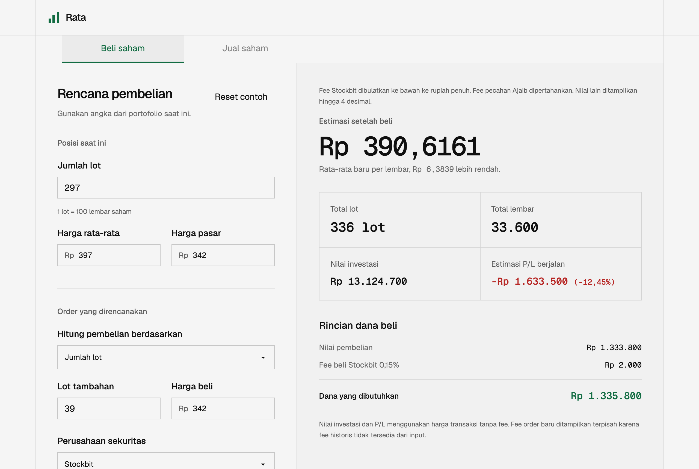
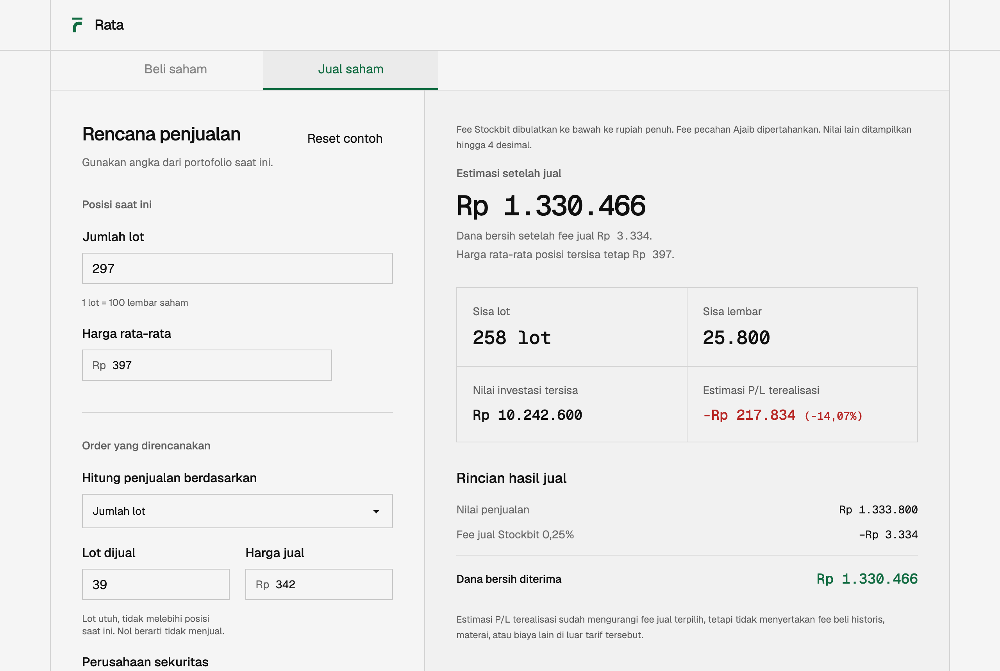
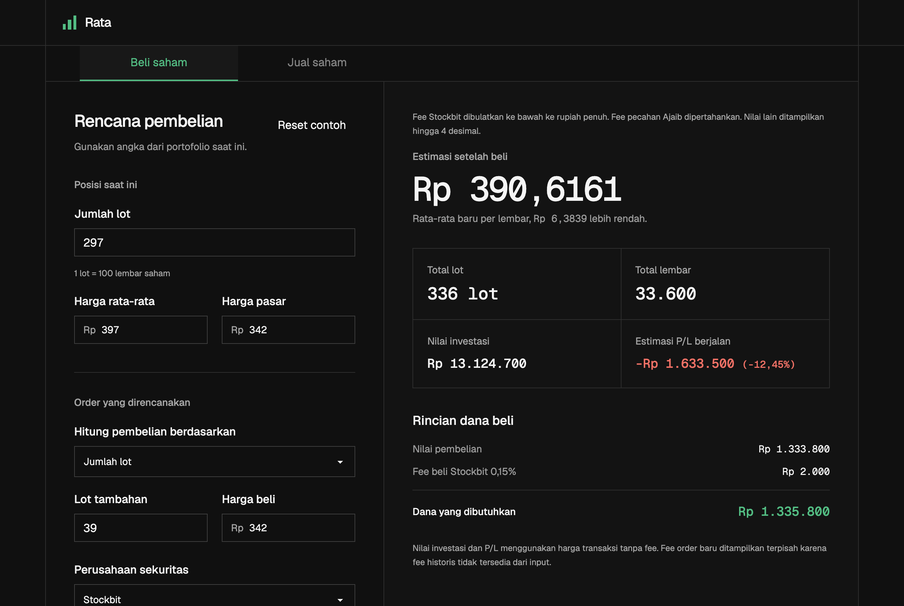
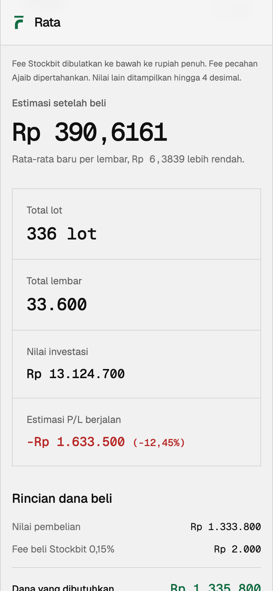

# Rata

Rata is a stock calculator for Indonesian equities. You enter your position and a planned order,
and Rata shows your new average price, the cash you need, your net proceeds, profit or loss, and
Stockbit or Ajaib fees before you send the order to your broker. Everything runs in your browser.

Live at [rata.ekel.dev](https://rata.ekel.dev).

## Screenshots

These show the default example: 297 lots at an average of Rp397, buying or selling 39 lots at
Rp342 through Stockbit.

| Buy                                                                                             | Sell                                                                                        |
| ----------------------------------------------------------------------------------------------- | ------------------------------------------------------------------------------------------- |
|  |  |

| Dark mode                                          | Mobile                                                                                             |
| -------------------------------------------------- | -------------------------------------------------------------------------------------------------- |
|  |  |

## Features

- **Buy:** new weighted average, cash needed including the buy fee, and the most whole lots a
  budget covers.
- **Sell:** net proceeds after the sell fee, realized profit or loss, and the fewest lots that reach
  a target net amount.
- **Target average:** the fewest lots to buy to bring your average down to a target price.
- **Fees:** published regular-stock rates for Stockbit and Ajaib.
- **Private and offline:** no network requests, storage, or analytics. It installs as a PWA and
  works offline.

## Calculation

```text
final average = (current lots × 100 × current average + new lots × 100 × buy price)
                ÷ ((current lots + new lots) × 100)
cash needed   = new lots × 100 × buy price + buy fee
net proceeds  = sold lots × 100 × sell price − sell fee
realized P/L  = net proceeds − sold lots × 100 × current average
```

- Averages and invested value use transaction prices. Fees appear on separate lines.
- Selling part of a position leaves the average of the remaining shares unchanged.
- Stockbit fees round down to the whole rupiah, which matches an observed Stockbit order. Ajaib fees
  keep their fractions.
- Realized profit or loss leaves out historical buy fees, because the inputs don't include them.

## Fees

| Brokerage | Buy fee | Sell fee | Source                                                                                                                        |
| --------- | ------: | -------: | ----------------------------------------------------------------------------------------------------------------------------- |
| Stockbit  |   0.15% |    0.25% | [help.stockbit.com](https://help.stockbit.com/id/article/transaksi-saham-berapa-biaya-trading-di-stockbit-sekuritas-1lbkyq9/) |
| Ajaib     | 0.1513% |  0.2513% | [ajaib.co.id/biaya](https://ajaib.co.id/biaya)                                                                                |

Ajaib's rates include the broker fee, the 0.0433% exchange levy, VAT, and the 0.1% final tax on
sales. Rata leaves out Ajaib's 0.1% market-order and 0.25% forced-sell surcharges, as well as the
Rp10.000 stamp duty on days above Rp10 million, because a single order can't show whether they
apply. Rates were last checked on 31 August 2026.

## Development

Built with SvelteKit, Svelte 5, TypeScript, Tailwind CSS 4, and daisyUI 5. It needs Bun 1.3.11 or
later.

```sh
bun install --frozen-lockfile
bun run dev     # http://localhost:5173
bun run lint    # Prettier and ESLint
bun run check   # svelte-check and TypeScript
bun run test    # Vitest
bun run build   # production build
```

CI runs lint, check, test, and build on pushes to `main` and on pull requests.

- `src/lib/rata.ts`: pure calculation functions. `rata.spec.ts` tests them, including the
  screenshot values.
- `src/routes/+page.svelte`: the calculator interface and its state.
- `src/routes/layout.css`: Tailwind, daisyUI themes, and design tokens.
- `vite.config.ts`: SvelteKit, PWA, content security policy, and the prerender origin.

## Deploying to Cloudflare Pages

| Setting          | Value                    |
| ---------------- | ------------------------ |
| Framework preset | SvelteKit                |
| Build command    | `bun run build`          |
| Output directory | `.svelte-kit/cloudflare` |
| Environment      | `BUN_VERSION=1.3.11`     |

The build script runs `bun install --frozen-lockfile` before Vite because Pages may not detect the
text-based `bun.lock`. If you move the site off `rata.ekel.dev`, update `prerender.origin` in
`vite.config.ts` so the canonical and link-preview URLs point to the new domain.

## Privacy and limitations

- Your inputs stay in your browser. The content security policy also blocks outbound connections.
- Results are planning estimates, not investment advice. Rounding, fee changes, and taxes can make
  them differ from your broker's statement, so check the final order with your broker.
